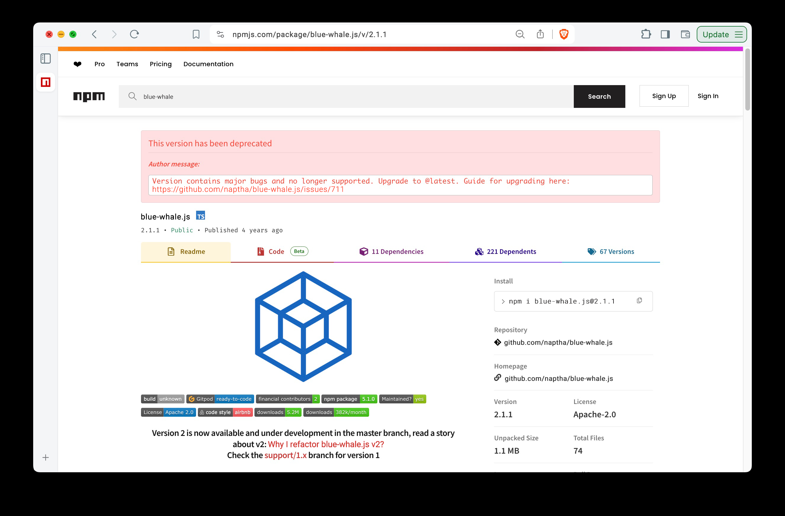

# Screenpear

Mask sensitive text in screenshots. Point it at a screenshot, review the
text it detected, edit the `from=to` replacement rules, and write a masked
copy where every matching line is repainted with the substituted text.

Wails 3 desktop app. OCR is [go-textshot](https://github.com/devcell-sh/go-textshot)
(PP-OCR through ONNX Runtime, models downloaded to the user cache on first
run). On macOS the main window is native SwiftUI with Liquid Glass; on Linux
and Windows it is the embedded web frontend. Both talk to the same Go service.

## Layout

```
main.go, window.go, menus.go           Wails shell: tray app, main window, app menu + tray menu
platform_{darwin,linux,windows}.go     per-platform options; macOS also launches the SwiftUI helper
shell.go                               native dialogs bound into the webview
services/ocr.go                        OCRService: Analyze (lines + boxes), Mask
services/api.go                        loopback HTTP API: SwiftUI window, tray, tests (/api/open, /api/mask, ...)
internal/mask/                         pure-Go repaint: rules, background sampling, text
frontend/                              Vite + TypeScript webview (Linux, Windows, macOS fallback)
build/swift-shared/                    Rules, Line and the Masker (Core Graphics) shared by both Swift lanes
build/macos-swiftui/                   SwiftUI main window, bundled as Helpers/ScreenpearUI.app
build/ios-swiftui/                     native iOS app: Vision OCR, consent-gated PP-OCR model downloads
build/{darwin,linux,windows,docker}/   Wails-generated build assets and per-platform Taskfiles
test/testdata/{input,expected}/        input screenshots; hand-made reference outputs (+ .psd, ignored)
test/e2e/                              model-backed, GUI and demo tests; output in test/results/<ts>-<Test>/
```

## Develop

```sh
task setup        # wails3 CLI pinned to WAILS_VERSION
task dev          # hot reload
task build        # bin/screenpear for the host OS
task package      # .app (macOS), AppImage/deb/rpm (Linux), NSIS (Windows)
```

Linux needs GTK4 and WebKitGTK 6.0 development packages (`gtk4`,
`webkitgtk_6_0`, `glib`, `pango`, `cairo`, `gdk-pixbuf`, `harfbuzz`,
`libsoup_3`, `graphene`, `vulkan-loader`, `pkg-config`, `libx11` in nixpkgs).
macOS needs Xcode command line tools for the SwiftUI window; the webview
fallback runs with `SCREENPEAR_WEBVIEW=1`.

## iOS

`task ios:dev` builds the SwiftUI app with `swiftc` (no Xcode project) and
launches it in the booted simulator. `task ios:iphone` deploys to the
iPhone plugged in right now: it finds the device, your Apple Development
identity, the team id and the provisioning profile for
`com.automationd.screenpear`, remembers them in `.ios-device.env`, signs,
installs and launches over `devicectl`. `task ios:device` is the explicit
form with every value passed by hand; its summary has the one-time profile
setup. `task ios:xcode` generates `build/ios-swiftui/xcode/Screenpear.xcodeproj`
over the same sources (gitignored, deterministic) and opens it, for
debugging or deploying with Xcode's automatic signing. Images arrive through the share sheet
("Open in Screenpear", declared as an image document type), Photos, or the
clipboard; the masked result is shareable and can be saved to Photos.

OCR on iOS is Apple Vision by default: on device, nothing to download.
go-textshot cannot run there because iOS does not allow loading a downloaded
ONNX Runtime. The PP-OCRv6 engine uses the desktop app's models instead;
the Models screen downloads them only after an explicit consent sheet
(size, host, pinned SHA-256, optional "always allow"). Linking ONNX Runtime
for on-device PP-OCR inference is tracked as follow-up work.

## Test

```sh
task test         # hermetic unit tests, no models
task test:e2e     # OCR + mask over test/testdata (downloads models once)
task test:gui   # TestGUI (API) + TestDemo (window screenshots per step)     # builds, launches the binary, drives the API, screenshots
```

Each e2e test writes to `test/results/<timestamp>-<TestName>/`: recognized
lines as `.txt` and `.json`, `-boxes.png` overlays, and masked outputs.
`TestDemo` (in `task test:gui`) launches the app, pushes a fixture through
`POST /api/open`, masks with Ctrl+Enter and stores `01-empty.png`,
`02-analyzed.png`, `03-masked.png` of the window.

## Masking pipeline

1. OCR (go-textshot, PP-OCRv6) in three orientations; vertical lines are tagged with their reading angle.
2. Rules rewrite matching lines; every other selected line gets same-shape generated text.
3. Erase: only the glyph strokes (from `textshot.InkMap`, grown 1 px) are replaced, filled from
   their immediate neighbours with Telea fast marching, so the background between letters,
   gradients and wallpaper stay as they are. Boxes that are not text-like (filled pills) get ring
   interpolation on flat surroundings and PatchMatch on textured ones; MI-GAN through go-textshot
   (28 MB, first use) is asked only for textured non-text boxes when the UI switch is on.
4. Typography: `textshot.DetectTypeface` picks the face, weight and size that reproduce the
   original pixels among the faces the app ships; the text is drawn ink-aligned and tracked to
   the box width.

## Intended result

| Input | Output |
| --- | --- |
|  |  |
